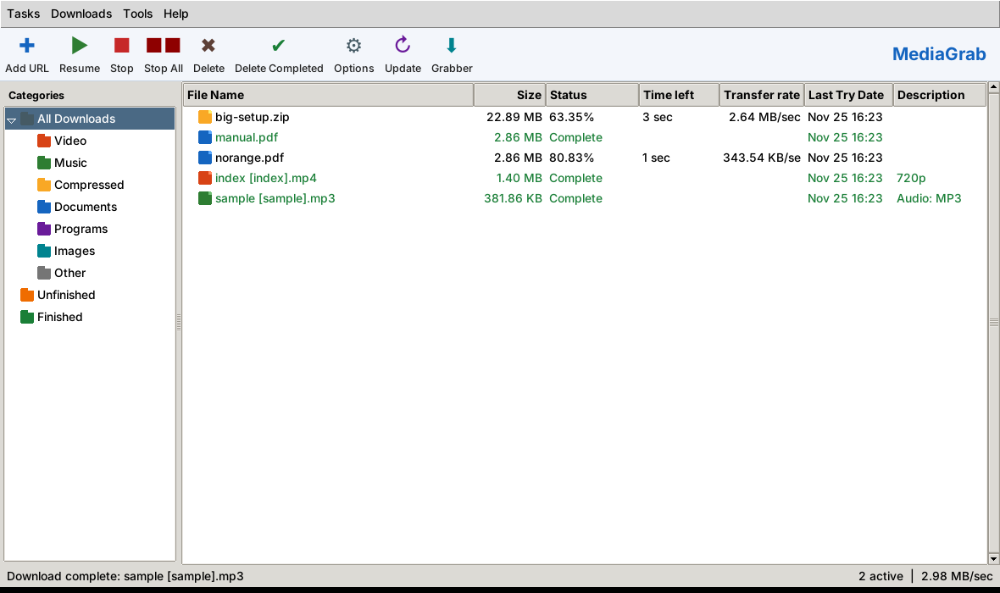
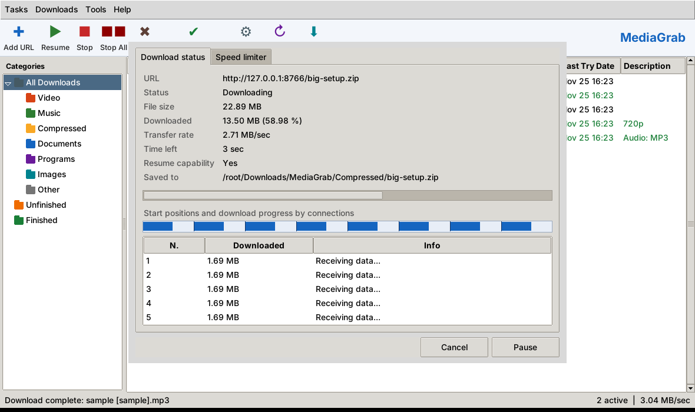
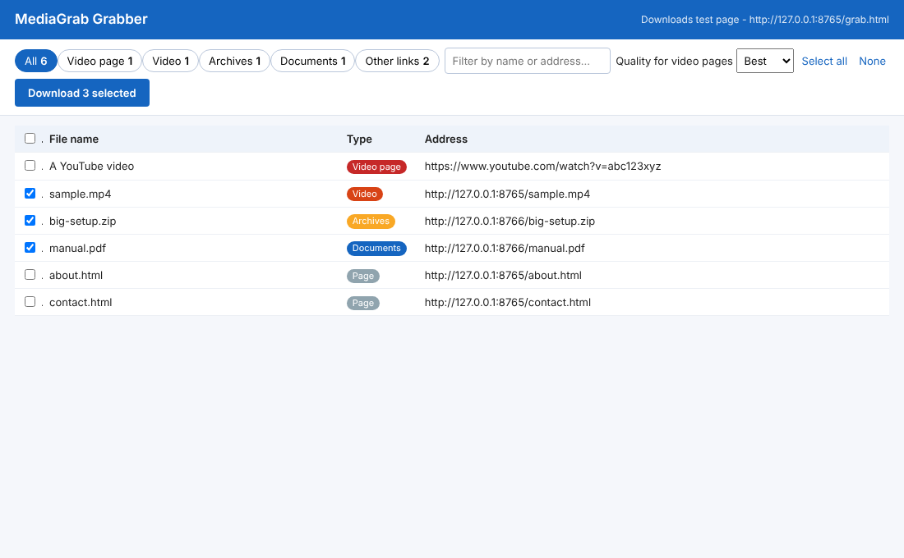
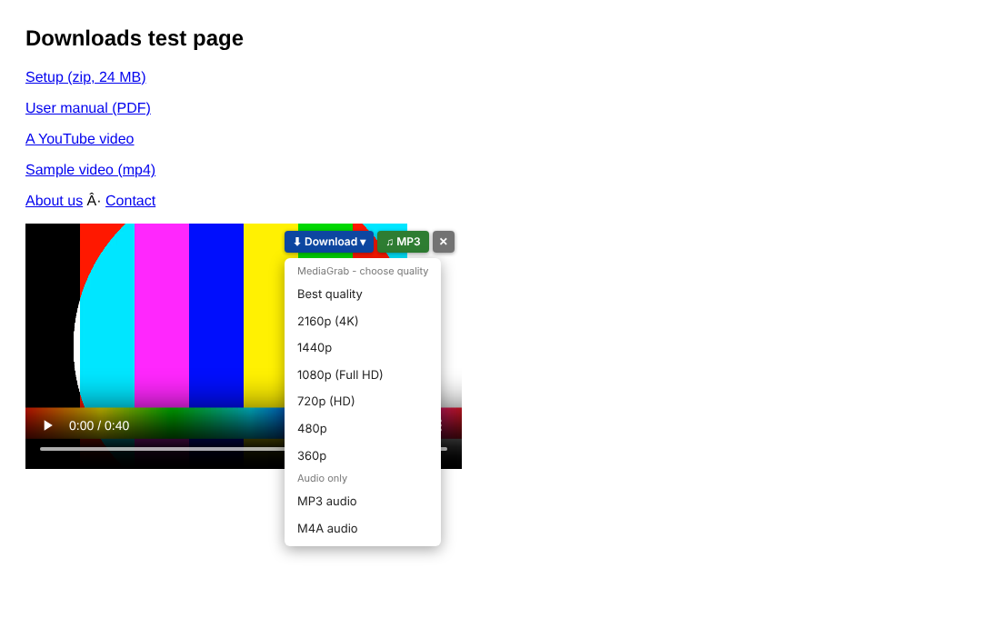
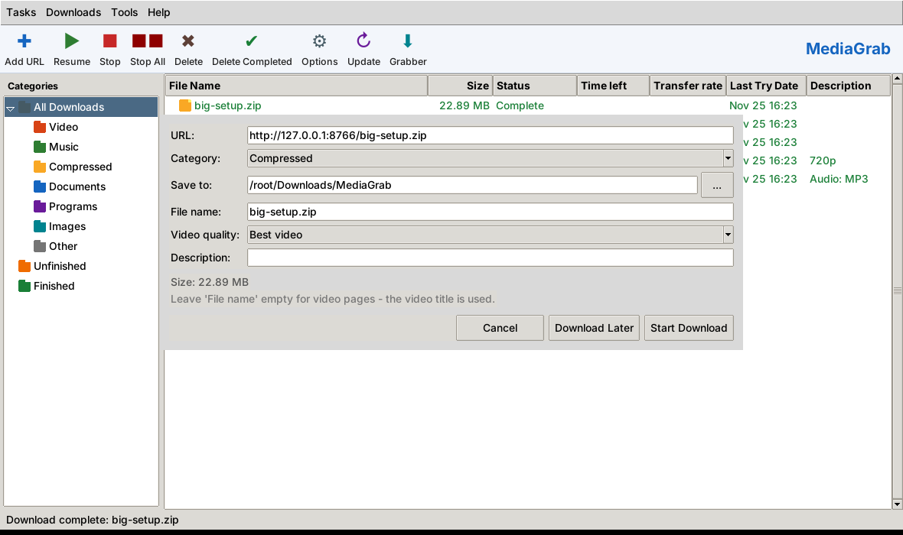

# MediaGrab Download Manager

A free download manager for Windows that works like IDM:

- **Video and audio** from YouTube, Facebook, Instagram, TikTok, X (Twitter), Vimeo, SoundCloud and [1000+ other sites](https://github.com/yt-dlp/yt-dlp/blob/master/supportedsites.md), in any quality from 4K down to 360p, or as **MP3 / M4A**.
- **Fast downloads of normal files** (zip, exe, iso, pdf, mp4...) using up to 16 connections per file, with **pause and resume**.
- **Browser integration** (Chrome, Edge, Brave): catches your browser downloads automatically, puts **Download / MP3** buttons on every video, and a **Grabber** that lists every link and media file on a page.
- **Updates itself** and its video engine automatically.

> **For personal use only.** Download only content you have the right to save, and respect each website's terms of service and copyright law. DRM-protected services (Netflix, Spotify, Disney+...) can't be downloaded.

## Install

1. Download **`MediaGrab-Setup.exe`** from the [latest release](https://github.com/eapasindu-sudo/MediaGrab/releases/latest) and run it. You don't need admin rights or Python, and yt-dlp and ffmpeg come included.
   Windows SmartScreen may warn because the app isn't signed. Click **More info > Run anyway**.
2. Install the browser extension (one time):
   1. Open `chrome://extensions` (Edge: `edge://extensions`).
   2. Turn on **Developer mode**.
   3. Click **Load unpacked** and choose the `extension` folder inside the MediaGrab install folder. In MediaGrab, **Help > Install browser extension...** opens that folder for you.
   4. Pin the blue MediaGrab icon to the toolbar.

## Using it

| You want to... | Do this |
| --- | --- |
| Download a video playing in the browser | Click **Download ▾** on the video and pick a quality, or click **MP3** for audio only |
| Download a file (zip, exe, pdf...) | Just click the download link as usual. MediaGrab catches it and shows the **Download File Info** window |
| Download many things from one page | Click the MediaGrab icon > **Grab links & media from this page**, tick what you want, then **Download selected** |
| Paste a link | **Add URL** in the toolbar (it fills in a link you copied) |
| Pause / continue | **Stop** and **Resume** (unfinished downloads also continue after you restart the PC) |
| See details | Double-click a download to open its progress window with each connection's progress |

Files are sorted into category folders inside `Downloads\MediaGrab` (Video, Music, Compressed, Documents, Programs, Images, Other). You can change this in **Options**.

| Download progress | Grabber |
| --- | --- |
|  |  |

| Quality menu on videos | Download File Info |
| --- | --- |
|  |  |

## Updates

When MediaGrab starts, it checks this repository for a new version and asks you to update (one click; downloads continue afterwards). It also updates yt-dlp once a day, which keeps YouTube, Facebook and Instagram working. Turn this off in **Options > General**.

## Problems?

| Problem | Fix |
| --- | --- |
| A video site stops working | Click **Update** in the toolbar (updates yt-dlp). |
| Facebook / Instagram says login required | **Options > Sites login**: choose the browser where you are logged in (Firefox works best), or use a `cookies.txt` file. |
| Browser downloads are not caught | Make sure MediaGrab is open, the extension is installed, and "Catch browser downloads" is ticked in the extension popup. File types are set in **Options > Browser**. |
| HD video has no sound / no MP3 | **Tools > Download / repair ffmpeg**. |
| Why did a download fail? | Right-click it > **Show error**. |

## For developers

| File | What it is |
| --- | --- |
| `mediagrab.py` | The app (Python 3.9+ and Tkinter, no other libraries needed) |
| `extension/` | Chrome/Edge extension (Manifest V3) |
| `installer.iss` | Inno Setup script for `MediaGrab-Setup.exe` |
| `.github/workflows/release.yml` | Builds the exe and installer on GitHub |
| `build_windows.bat`, `run_mediagrab.bat` | Build or run locally on Windows |

**To release a new version:** raise `VERSION` in `mediagrab.py` and push to `main`. GitHub builds the installer and publishes release `v<VERSION>`, and installed copies then update themselves.

The extension talks to the app only on your own computer (`127.0.0.1:9614`). The app rejects requests from ordinary websites, so a web page can't add downloads by itself.
